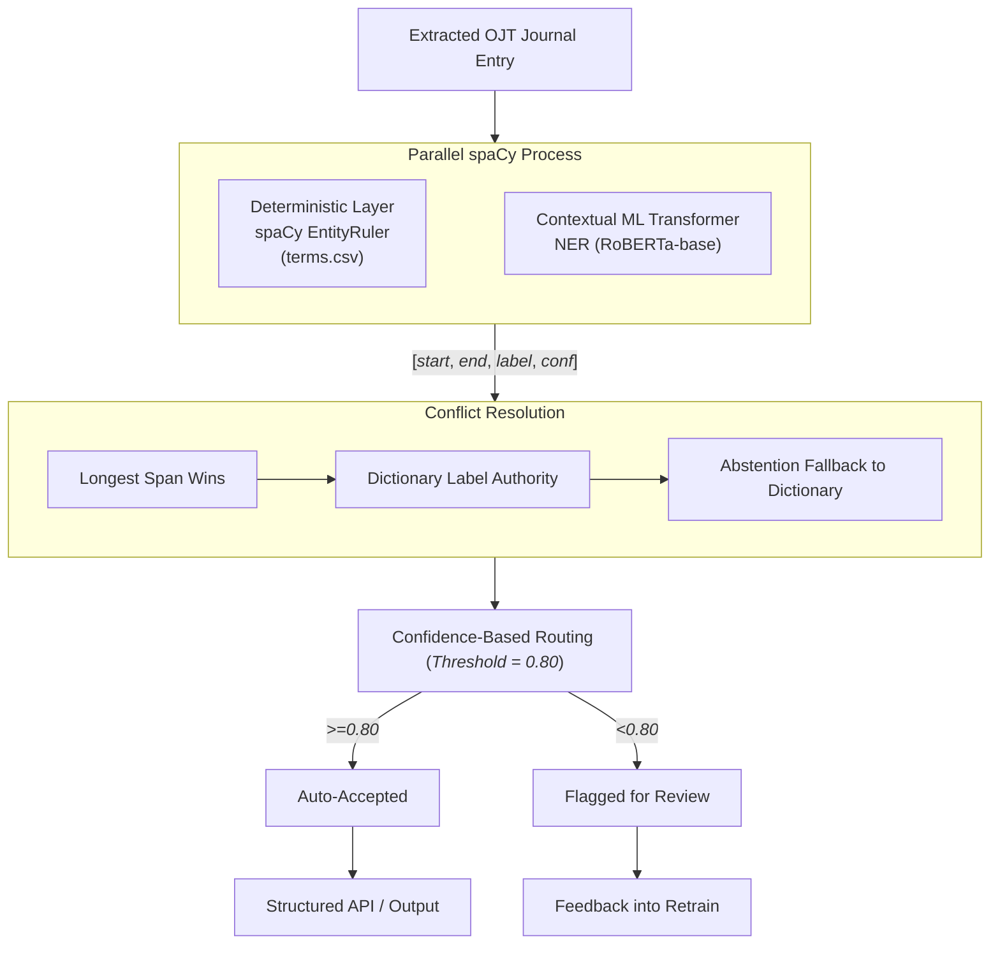

# Hybrid NER + Classification Pipeline for OJT Journal Task Tagging

[](https://www.python.org/)
[](https://spacy.io/)
[](https://huggingface.co/roberta-base)
[](https://www.nvidia.com/)

A modular, production-ready hybrid system designed for processing On-the-Job Training (OJT) weekly student internship journals. It automatically extracts, categorizes, and routes task entities into **IT** (`IT_TERM`) or **CLERICAL** (`CLERICAL_TERM`).

The pipeline integrates deterministic institutional vocabulary matching with a contextual RoBERTa Transformer NER model, resolved through a robust multi-invariant conflict resolution layer, confidence routing, and hard negative mining.

---

## 1. Architectural Design

Rather than relying on a naive dictionary lookup or an ungrounded flat NER model, this system implements a **two-layer hybrid architecture** with parallel extraction and explicit **Dictionary-label-authority** conflict resolution:



### Core Pipeline Invariants

1. **Longest Span Wins**: Shorter dictionary terms never truncate or split a longer contextual ML extraction. For example, `Tailwind CSS` takes precedence over dictionary `CSS`, and `access control systems` beats `access control`.
2. **Dictionary Label Authority**: When the contextual Transformer and the seed dictionary fire on overlapping spans and disagree on the task category, the curated seed Dictionary takes precedence as institutional ground truth. The ML prediction's category is overridden by the dictionary label (e.g., overriding ML `IT_TERM` to `CLERICAL_TERM` for `student records` and `Record management systems`, or overriding ML `CLERICAL_TERM` to `IT_TERM` for `office database` and `database`). All override events are logged to `data/eval_results/dictionary_overrides.jsonl` for auditability.
3. **Abstention Fallback**: When the Transformer makes no prediction (abstains) on a span matching a seed dictionary term, the dictionary entry is accepted as a standalone extraction, ensuring zero-shot recovery of institutional vocabulary without false-positive boundary splits.
4. **Confidence-Based Routing**: Entities with confidence scores $\ge 0.80$ are marked `ACCEPTED`. Low-confidence extractions ($< 0.80$) are flagged as `NEEDS_REVIEW` for human audit.

---

## 2. Project Directory Structure

```text
spaCy-training/
├── README.md                          # Repository overview & research findings
├── main.ipynb                         # Narrative end-to-end training & evaluation pipeline
├── config_trf.cfg                     # spaCy GPU transformer training configuration
├── requirements.txt                   # Environment package dependencies
├── api/
│   ├── __init__.py
│   ├── main.py                        # FastAPI entity extraction HTTP endpoint
│   └── README.md                      # API documentation, curl examples & PHP integration
├── data/
│   ├── README.md                      # Comprehensive data guide, schemas, partitions & leakage audit
│   ├── terms.csv                      # Seed dictionary (372 terms: 215 IT, 157 Clerical)
│   ├── data.jsonl                     # Real authentic annotated OJT journal dataset (1,320 records)
│   ├── synthetic_paraphrases.jsonl    # T5 seq2seq generated paraphrases (565 records)
│   ├── synthetic_llm_generated.jsonl  # Gemini LLM-direct synthetic records (571 records)
│   ├── training_trstr_paraphrase.jsonl # Combined real + paraphrase training pool (1,488 records)
│   ├── training_trstr_llm.jsonl       # Combined real + LLM + mined negatives pool (1,588 records)
│   ├── training/
│   │   ├── train.spacy                # Real training partition (923 docs, 1,032 entities)
│   │   ├── dev.spacy                  # Real validation partition (198 docs, 208 entities)
│   │   ├── test.spacy                 # Real held-out test partition (199 docs, 233 entities)
│   │   ├── train_trstr_paraphrase.spacy # Paraphrase-augmented DocBin (1,488 docs, 1,416 entities)
│   │   └── train_trstr_llm.spacy      # LLM-augmented DocBin (1,588 docs, 1,587 entities)
│   ├── test/
│   │   ├── unseen_benchmark.jsonl     # Out-of-vocabulary benchmark (85 docs, 65 gold entities)
│   │   ├── holdout.jsonl              # Permanent real-world holdout evaluation set
│   │   └── raw/                       # Raw unannotated journal text files
│   ├── cv/
│   │   ├── cv_metadata_5fold.json     # 5-fold cross-validation partition splits and metadata
│   │   ├── results/                   # Cross-validation evaluation reports per condition
│   │   ├── fold_0/ ... fold_4/        # 5-fold cross-validation DocBins (val_real, train_trtr, etc.)
│   │   ├── cv_3way_results.json       # 5-fold cross-validation results across the three main conditions
│   │   └── cv_trstr_llm_cnn_results.json # 5-fold TRSTR-LLM CNN results
│   ├── eval_results/                  # Evaluation outputs partitioned by evaluation type
│   │   ├── comparison/                # Test split and benchmark comparison outputs
│   │   │   ├── trtr/                  # TRTR test partition reports & unseen benchmark outputs
│   │   │   ├── trstr_paraphrase/      # TRSTR-Paraphrase reports & unseen benchmark outputs
│   │   │   └── trstr_llm/             # TRSTR-LLM reports & unseen benchmark outputs
│   │   └── dictionary_overrides.jsonl # Canonical cumulative log of dictionary conflict overrides
│   ├── evaluation_report_3way_comparison.json # Side-by-side test partition evaluation report
│   └── review/
│       └── mined_hard_negatives.jsonl # Mined hard negative candidates (164 raw, 94 clean accepted)
├── models/
│   ├── ner_trf/                       # Default deployment model (model-best)
│   ├── ner_trf_trtr/                  # TRTR baseline model checkpoints (model-best, model-last)
│   ├── ner_trf_trstr_paraphrase/      # TRSTR-Paraphrase augmented model (model-best, model-last)
│   ├── ner_trf_trstr_llm/             # TRSTR-LLM augmented model (model-best, model-last)
│   └── cv/                            # Cross-validation model checkpoints per fold (e.g., trtr_f0)
├── scripts/
│   ├── README.md                      # Comprehensive guide to all 12 pipeline scripts
│   ├── __init__.py                    # Automatic CUDA dynamic linker preloader (`init_gpu()`)
│   ├── annotation.py                  # Real-data ingestion, diagnostics, dedup & DocBin generation
│   ├── check_data_leakage.py          # 7-check data leakage & evaluation benchmark isolation audit
│   ├── cross_validation.py            # 5-fold grouped & stratified CV (TRTR vs. Para vs. LLM)
│   ├── eval.py                        # Precision, Recall, F1 evaluation on test split & unseen benchmark
│   ├── generate_llm_synthetic.py      # LLM-direct synthetic data generation (Google Gemini)
│   ├── labels.py                      # Canonical label taxonomy (`IT_TERM`, `CLERICAL_TERM`)
│   ├── mine_negatives.py              # Hard negative mining & stylistic n-gram overlap analysis
│   ├── pipeline.py                    # HybridJournalPipeline inference & conflict resolution
│   ├── prepare_trstr_llm.py           # TRSTR-LLM dataset builder merging real, synthetic & negatives
│   ├── test_pipeline_regressions.py   # Unittest regression suite for conflict resolution rules
│   └── training.py                    # Transformer fine-tuning script with early stopping & patience
├── docs/
│   ├── annotation_guidelines.md       # Official annotation guidelines & label taxonomy
│   ├── manual_annotation_guidelines.md# Quick reference guide for human annotators
│   ├── deployment.md                  # Minimal production standalone deployment guide
│   ├── hard_negative_mining.md        # Hard negative mining methodology & leakage isolation
│   ├── synthetic_augmentation_methodology.md # Full 3-way evaluation methodology & ablation analysis
│   ├── paraphrase_augmentation_methodology.md # Documentation of T5 paraphrasing
│   └── chapter4.md                    # Results & Discussion chapter (empirical findings, error analysis, language effects)
|
└── tools/
    ├── README.md                      # Guide to desktop GUI tools
    ├── pipeline_gui.py                # Desktop GUI Studio for interactive inference & batch processing
    ├── entity_extractor_gui.py        # Launcher alias for pipeline_gui.py
    ├── jsonl_editor.py                # Interactive JSONL dataset viewer & span annotation editor
    └── spacy_annotator_app.py         # Lightweight rapid span annotation helper
```

---

*For full dataset specification, taxonomy, and partition details, see the dedicated [data/README.md](data/README.md).*

---

## 4. Empirical Evaluation Results

To rigorously assess performance and generalization, the three main experimental conditions were evaluated under identical training hyperparameters (`max_steps=2500`, `eval_frequency=50`, `patience=400`, GPU device 0).

1. **TRTR (Train Real, Test Real)**: Baseline trained exclusively on **923** authentic journal entries.
2. **TRSTR-Paraphrase**: Trained on **923** real records + **565** accepted T5 seq2seq paraphrases (**1,488** total).
3. **TRSTR-LLM**: Trained on **923** real records + **571** Gemini LLM synthetic records + **94** clean mined hard negatives (**1,588** total).

### 4.1 Side-by-Side Test Partition Evaluation

Evaluated against the identical authentic held-out test split (`data/training/test.spacy`, 199 docs, 233 entities) and controlled out-of-vocabulary benchmark (`data/test/unseen_benchmark.jsonl`, 85 docs, 65 gold entities) from `main.ipynb`:

| Evaluation Metric | TRTR (Real Baseline) | TRSTR-Paraphrase (T5) | TRSTR-LLM (Gemini) | Delta (Para vs TRTR) | Delta (LLM vs TRTR) |
| :--- | :---: | :---: | :---: | :---: | :---: |
| **Held-Out Test Overall F1** | **71.27%** | 66.22% | 64.85% | -5.05% | -6.42% |
| Held-Out Test Overall Precision | 71.74% | 69.16% | 68.75% | -2.58% | -2.99% |
| Held-Out Test Overall Recall | **70.82%** | 63.52% | 61.37% | -7.30% | -9.45% |
| ├── `IT_TERM` F1 | **71.52%** | 66.03% | 64.65% | -5.49% | -6.87% |
| ├── `IT_TERM` Precision | 72.90% | 67.53% | 70.59% | -5.37% | -2.31% |
| ├── `IT_TERM` Recall | **70.19%** | 64.60% | 59.63% | -5.59% | -10.56% |
| ├── `CLERICAL_TERM` F1 | **70.75%** | 66.67% | 65.28% | -4.08% | -5.47% |
| ├── `CLERICAL_TERM` Precision | 69.33% | **73.33%** | 65.28% | +4.00% | -4.05% |
| └── `CLERICAL_TERM` Recall | **72.22%** | 61.11% | 65.28% | -11.11% | -6.94% |
| **Unseen Benchmark TRF Precision** | 35.92% | 32.50% | **61.54%** | -3.42% | **+25.62%** |
| **Unseen Benchmark TRF Recall** | 78.46% | 60.00% | **86.15%** | -18.46% | **+7.69%** |
| **Unseen Benchmark TRF F1** | 49.28% | 42.16% | **71.79%** | -7.12% | **+22.51%** |
| **Unseen Benchmark Hybrid Precision** | 35.66% | 33.61% | **56.00%** | -2.05% | **+20.34%** |
| **Unseen Benchmark Hybrid Recall** | 78.46% | 63.08% | **86.15%** | -15.38% | **+7.69%** |
| **Unseen Benchmark Hybrid F1** | 49.04% | 43.85% | **67.88%** | -5.19% | **+18.84%** |

### 4.2 5-Fold Stratified Cross-Validation Summary

> **Cross‑Validation Results**: The 5‑fold cross‑validation on the expanded 1,320‑record dataset has completed. The aggregated metrics (mean ± standard deviation) for each experimental condition are shown below.

| Metric | TRTR (Real Baseline) | TRSTR‑Paraphrase | TRSTR‑LLM |
| :--- | :---: | :---: | :---: |
| **Overall F1** | 71.71 ± 2.80% | 71.47 ± 0.92% | 67.95 ± 1.41% |
| Overall Precision | 69.17 ± 2.79% | 69.19 ± 1.61% | 66.05 ± 1.74% |
| Overall Recall | 74.46 ± 3.14% | 73.99 ± 2.10% | 69.99 ± 1.74% |
| IT‑Term F1 | 72.61 ± 3.78% | 72.33 ± 1.45% | 68.82 ± 1.61% |
| Clerical‑Term F1 | 70.05 ± 2.39% | 70.08 ± 2.00% | 66.36 ± 1.53% |
| Unseen Benchmark Recall (Transformer) | 79.08 ± 5.02% | 77.23 ± 6.56% | **92.00 ± 5.45%** |
| Unseen Benchmark F1 (Transformer) | 50.85 ± 2.31% | 50.58 ± 2.11% | **72.16 ± 4.13%** |
### Chapter 4 Detailed Discussion

The complete Chapter 4 discussion is now available in [`docs/chapter4.md`](docs/chapter4.md), which expands the empirical results with:

- **Discussion**: Which category performed better (TRTR vs. TRSTR-Paraphrase vs. TRSTR-LLM) and under what conditions.
- **Error analysis**: Types of errors observed, including missed entities, misclassified entities, and ambiguous terms.
- **Language mixing effects**: How English, Filipino, or mixed-language expressions in the Weekly Activity Reports (WARs) affected the results.

### Key Findings & Thesis Insights

1. **TRSTR-LLM Provides the Strongest OOV Recall in the Three-Way Run**: On the 65-entity unseen benchmark, TRSTR-LLM reached **86.15% transformer recall** and **71.79% transformer F1**, compared with TRTR's 78.46% recall and 49.28% F1. Its hybrid mode reached **67.88% F1**.
2. **TRTR Remains the Best Held-Out Test Baseline**: The real-only baseline achieved **71.27% held-out F1**, **71.74% precision**, and **70.82% recall** in the current comparison report.
3. **TRSTR-Paraphrase Has the Most Stable Cross-Validation**: It achieved **71.47 ± 0.92% overall F1** across five folds, while TRTR reached 71.71 ± 2.80% and TRSTR-LLM reached 67.95 ± 1.41%.
5. **Strict Evaluation Isolation Maintained**: All 7 checks of the automated leakage audit passed with zero leakage. Synthetic data remains strictly isolated to the training split. Evaluation partitions (`dev.spacy`, `test.spacy`, `unseen_benchmark.jsonl`) remain 100% authentic real data.

---

## 5. Quick Start & Usage

### Environment Setup

Activate the Python virtual environment:

```bash
source .venv/bin/activate
```

### 1. Run the Narrative Walkthrough Notebook

Open `main.ipynb` in Jupyter Lab or VS Code to step through data ingestion, leakage checks, training, evaluation, and cross-validation:

```bash
jupyter lab main.ipynb
```

### 2. Run Pipeline Steps via CLI

#### Prepare Data & Build Binary DocBins

```bash
python scripts/annotation.py
```

#### Run 7-Check Data Leakage Audit

```bash
python scripts/check_data_leakage.py
```

#### Train the Transformer on GPU

```bash
python scripts/training.py --steps 2500 --eval-freq 50 --patience 400 --gpu-id 0
```

#### Run 5-Fold Cross-Validation

```bash
python scripts/cross_validation.py --folds 5 --conditions trtr,trstr_paraphrase,trstr_llm
```

checkpoint and result directories so they do not overwrite the main CV outputs.

#### Run Full Evaluation & Save Comparison Reports

```bash
python scripts/eval.py \
  --model-path models/ner_trf/model-best \
  --run-label trtr
```

*(Automatically routes per-item JSONL logs and reports into `data/eval_results/comparison/trtr/`)*

#### Run Hybrid Pipeline Regression Unit Tests

```bash
python -m unittest scripts/test_pipeline_regressions.py
```

#### Test Hybrid Inference in Python

```python
from scripts.pipeline import HybridJournalPipeline

pipe = HybridJournalPipeline(model_path="models/ner_trf/model-best", terms_csv_path="data/terms.csv")
res = pipe.predict("I developed an asynchronous microservice using FastAPI and PostgreSQL.")
for ent in res["entities"]:
    print(f"[{ent['category']}] {ent['term']} ({ent['source']}, conf: {ent['confidence']:.2f})")
```

---

## 6. Applications & Services

### 1. FastAPI Entity Extraction Service (`api/`)

Provides a production HTTP API for real-time entity extraction:

```bash
uvicorn api.main:app --host 0.0.0.0 --port 8000
```

- Endpoint: `POST /extract`
- Health check: `GET /health`
- See [`api/README.md`](api/README.md) for request/response contracts and PHP integration code.
- See [`docs/deployment.md`](docs/deployment.md) for packaging the API onto a standalone server.

### 2. Desktop GUI Studio (`tools/pipeline_gui.py`)

An interactive desktop suite featuring live visual entity tagging, instant KPI analytics, model switching, filtering, and JSON/cURL generators:

```bash
python tools/pipeline_gui.py
```

- Launcher alias: `python tools/entity_extractor_gui.py`
- Dataset curation: `python tools/jsonl_editor.py`
- See [`tools/README.md`](tools/README.md) for full desktop utility documentation.
